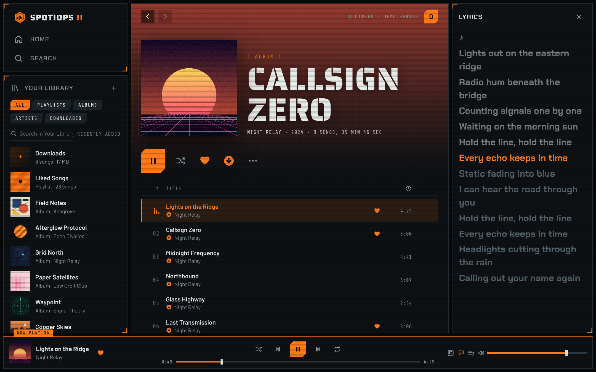
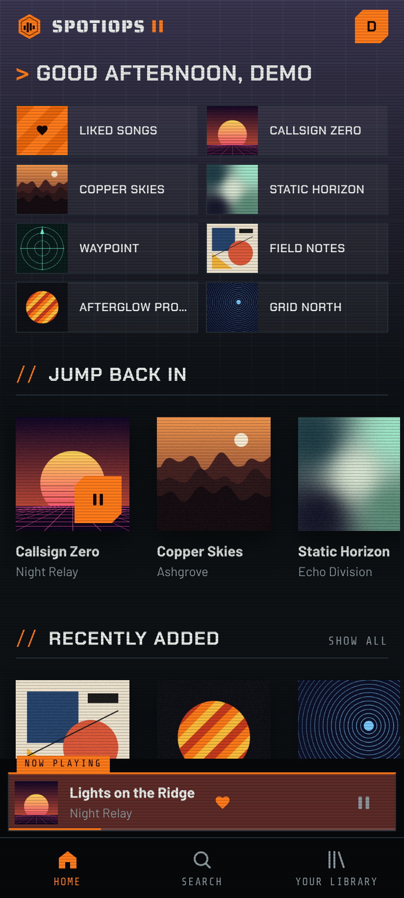
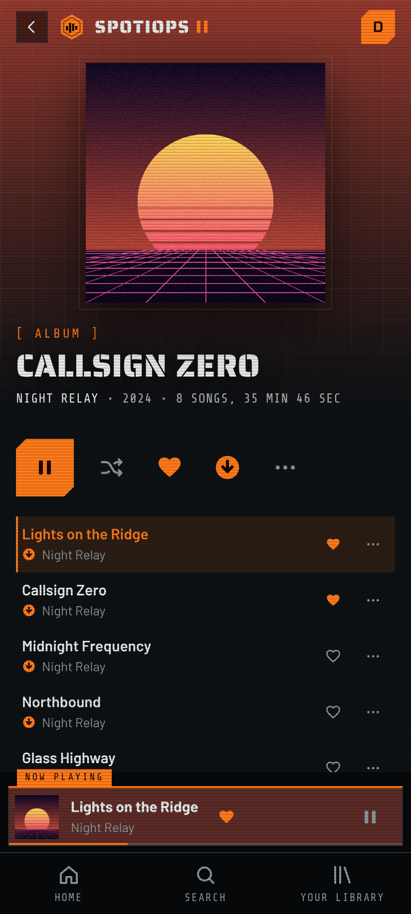
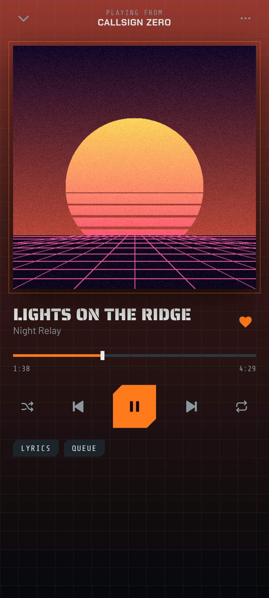
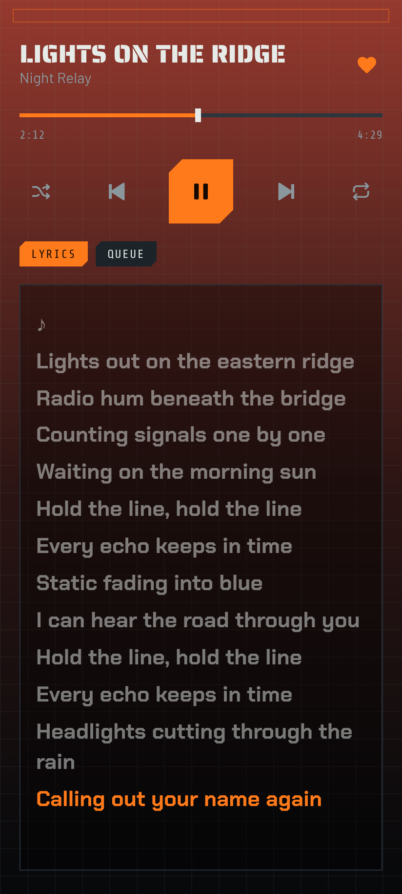
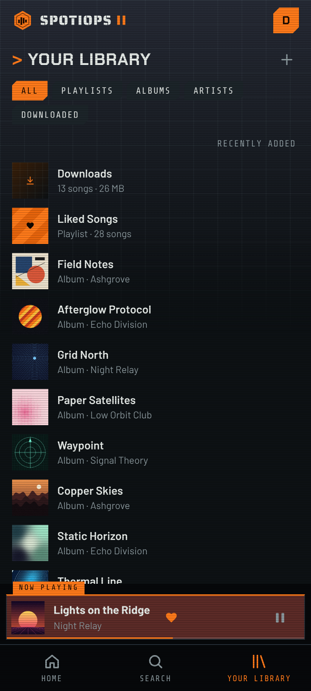
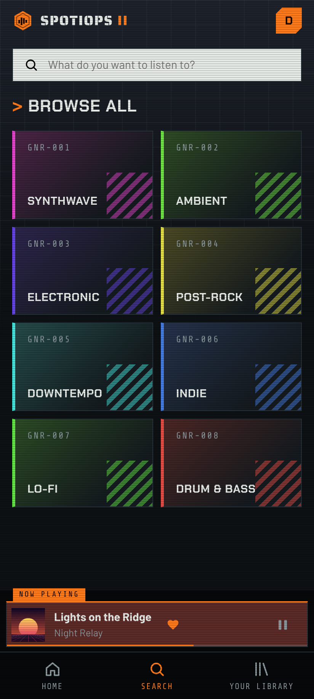
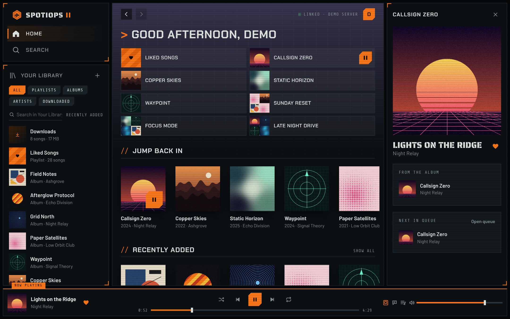

# Spotiops II

A music player for your own Jellyfin server, with offline downloads, synced
lyrics and a privacy mode. It runs as an Android app and in any web browser.

  

  
  
  

  
  
  

  

Screenshots use a made-up demo library: the artists, albums, cover art and lyrics are invented.

## What the Android app adds

The app wraps the same player you use in the browser
(`app/src/main/assets/index.html`) and adds:

- music that keeps playing when you leave the app or lock the screen
- a playback notification plus lock-screen and headphone controls
- offline listening: downloaded songs are stored inside the app and play without a connection
- the Android back button moving back through pages

## Get the APK without installing anything (GitHub)

1. Create a new empty repository on github.com.
2. Upload everything in this folder to it, including the hidden `.github` folder.
   (Drag the files into "uploading an existing file", or push with git.)
3. Open the repository's **Actions** tab. The "Build APK" job starts by itself
   and takes about 5 minutes.
4. When it shows a green tick, open the run and download **SpotiopsII-apk**
   under Artifacts. Unzip it to get `SpotiopsII.apk`.

## Build it on your computer (Android Studio)

1. Install Android Studio, then choose **Open** and pick this folder.
2. Wait for it to finish syncing (it downloads what it needs the first time).
3. Choose **Build > Build App Bundle(s) / APK(s) > Build APK(s)**.
4. The APK is in `app/build/outputs/apk/`.

## Install on your phone

Copy the APK to your phone and open it. Android will ask you to allow installs
from that app (your browser or file manager) the first time. Google Play Protect
may warn that it doesn't recognise the app, because it isn't from the Play
Store. Choose to install anyway.

## Downloads and offline listening

Tap the download button next to play on an album, a playlist or Liked Songs, or
use ••• > Download on a single song. Songs are saved inside Spotiops II (not as
files in your phone's music folder) and play when you have no connection. Saved
albums and playlists stay in step with your server: new songs download and
removed songs are deleted next time you open them while connected.

Your Jellyfin account needs **Allow media downloading** turned on (Jellyfin
Dashboard > Users > your user). Signing out hides that account's downloads;
clearing the app's storage in Android settings deletes them.

## Updating the player

Replace `app/src/main/assets/index.html` with a newer `spotiops-ii.html`
(renamed to `index.html`) and build again.
